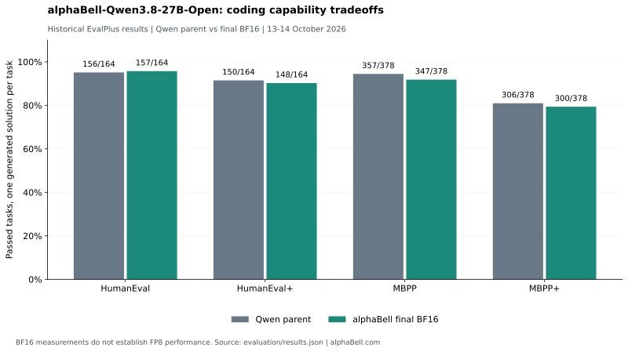

# alphaBell-Qwen3.8-27B-Open

**A 27B Qwen research derivative for studying refusal behavior and capability tradeoffs, developed by [alphaBell](https://alphabell.com).**

This repository contains the model documentation, recovered coding evaluation results and evaluation client for alphaBell-Qwen3.8-27B-Open. The model combines abliteration with supervised fine-tuning and is intended for noncommercial research into post-training and model behavior.

[Hugging Face weights](https://huggingface.co/alphabell/alphaBell-Qwen3.8-27B-Open-FP8) · [Evaluation explorer](https://huggingface.co/spaces/alphabell/Qwen-Open-Explorer) · [Release article](https://huggingface.co/blog/alphabell/qwen-open-27b)

[BF16 model card](model-cards/BF16.md) · [FP8 model card](model-cards/FP8.md) · [Evaluation records](evaluation/results.json) · [Reproducing evaluations](reproducing-evaluations.md) · [License](LICENSE)

## Download and run

Get the FP8 checkpoint from [Hugging Face](https://huggingface.co/alphabell/alphaBell-Qwen3.8-27B-Open-FP8) or the [GitHub mirror](https://github.com/alphabell-research/alphabell-qwen-open/releases/tag/v0.1.0-fp8), about 30.9 GB. The standard-library download client reconstructs larger Safetensors files from release assets and verifies every part and completed file with SHA-256. Existing complete files are verified and reused when rerunning the client.

```bash
git clone https://github.com/alphabell-research/alphabell-qwen-open.git
cd alphabell-qwen-open
python3 download_model.py --output ./alphaBell-Qwen3.8-27B-Open-FP8
```

The following reference test dequantizes FP8 weights to BF16 in RAM and runs entirely on CPU. The decoded weights alone occupy about 55.6 GB, with additional memory needed for loading and inference. It uses eight CPU threads and requires no remote model code.

```bash
python3 -m venv .venv-inference
.venv-inference/bin/python -m pip install -r requirements-inference.txt
.venv-inference/bin/python evaluation/inference.py \
  --model ./alphaBell-Qwen3.8-27B-Open-FP8 --dequantize-fp8
```

The recorded output is `Hello, 2 + 3 is 5.` See the [FP8 smoke test](evaluation/smoke-test-fp8.json) for exact settings. Native GPU FP8 execution and full FP8 coding results need separate evaluation.

## Coding comparison



| Benchmark | Qwen parent | alphaBell final BF16 | Difference |
| --- | ---: | ---: | ---: |
| HumanEval | 156/164, 95.12% | 157/164, 95.73% | +0.61 percentage points |
| HumanEval+ | 150/164, 91.46% | 148/164, 90.24% | -1.22 percentage points |
| MBPP | 357/378, 94.44% | 347/378, 91.80% | -2.65 percentage points |
| MBPP+ | 306/378, 80.95% | 300/378, 79.37% | -1.59 percentage points |

The final BF16 checkpoint passes one more HumanEval task and fewer tasks on the other three test suites. This comparison does not establish a general coding improvement or FP8 parity.

The parent was evaluated on 13 October 2026 and the final BF16 model on 14 October 2026. Each run used one solution per task, temperature 0, a 16,384-token generation limit and thinking mode enabled. EvalPlus sanitized the generated Python before scoring. Two final HumanEval generations reached the token limit; none did on MBPP.

## Lineage and training

The parent is [Qwen/Qwen3.8-27B](https://huggingface.co/Qwen/Qwen3.8-27B), revision `1d4bf0f2ff6012fd82039f2fa52739d0dd7c60c0`, using the `Qwen3_5ForConditionalGeneration` architecture. The vocabulary, added tokens and chat template are preserved from the parent. Tokenizer serialization was updated during export.

Post-training combines abliteration and supervised fine-tuning on lab-generated instruction and response pairs, with reasoning responses included in the later stage. Benign replay uses 160 examples from [tatsu-lab/alpaca](https://huggingface.co/datasets/tatsu-lab/alpaca), sampled with seed 7. The dataset revision was not recorded.

The BF16 model contains 27,781,427,952 parameter elements including the multi-token prediction head. The FP8 variant uses E4M3 weights in 128 × 128 blocks and retains BF16 tensors. See the individual cards for format details. This repository contains documentation and evaluation material; model weight files are separate artifacts.

## Scope of the evidence

The reported benchmarks cover text generation. Vision, video and long-context quality have not been independently evaluated for this derivative. Changing refusal behavior does not establish accuracy, successful task completion or safety. The model can produce incorrect, biased or harmful responses, and its suitability for production or high-stakes use has not been established.

The evaluation client and historical task-level pass/fail records are provided for independent study. Report the checkpoint format, backend, dataset hashes, generation settings and failures with any new comparison.

## Recorded BF16 smoke test

On 21 October 2026, the local BF16 checkpoint loaded with PyTorch 2.13.0 and Transformers 5.17.0 on CPU, using `Qwen3_5ForConditionalGeneration` with `trust_remote_code=False`. With thinking disabled and deterministic generation, it answered the prompt “Reply with one short sentence: hello, and what is 2 + 3?” with “Hello, 2 + 3 is 5.”

This was a 12-token functional smoke test. A separate FP8 check on 22 October 2026 loaded and dequantized the source checkpoint into BF16 on CPU, using Transformers 5.19.0 and Accelerate 1.15.0. It produced the same answer. The test selected native CPU reference kernels in the running process, as recorded in its JSON output. These checks establish local loading and a benign response. See the [BF16 record](evaluation/smoke-test.json), [FP8 record](evaluation/smoke-test-fp8.json) and [CPU test script](evaluation/inference.py).

## License and credit

alphaBell's model contributions and accompanying research material are licensed for noncommercial research under the [alphaBell Research Noncommercial License](LICENSE), identifier `alphabell-research-noncommercial`. The standalone evaluation and inference scripts are separately licensed under [Apache License 2.0](licenses/CODE_APACHE_2.0.txt), as identified in their headers.

The Qwen parent's original material remains under [Apache 2.0](licenses/QWEN_APACHE_2.0.txt). Alpaca replay data is under [CC BY-NC 4.0](licenses/ALPACA_DATA_LICENSE.txt), and Stanford's [Alpaca usage notice](https://github.com/tatsu-lab/stanford_alpaca#readme) specifies research use for models trained using that data. The derivative's research restriction reflects this provenance. These licenses do not expand rights in third-party material. See [NOTICE](NOTICE) for attribution.

Developed by [alphaBell](https://alphabell.com), building on Qwen, Stanford Alpaca and EvalPlus.
